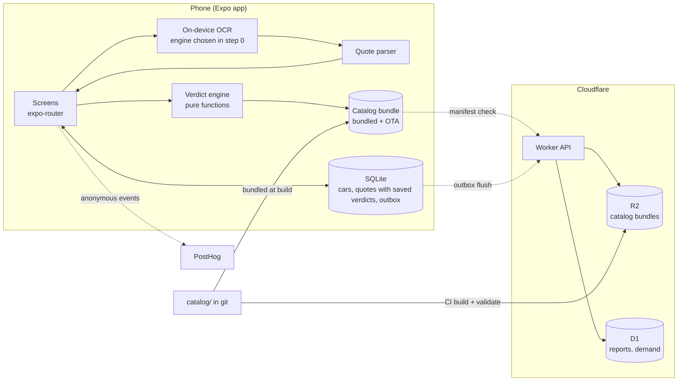
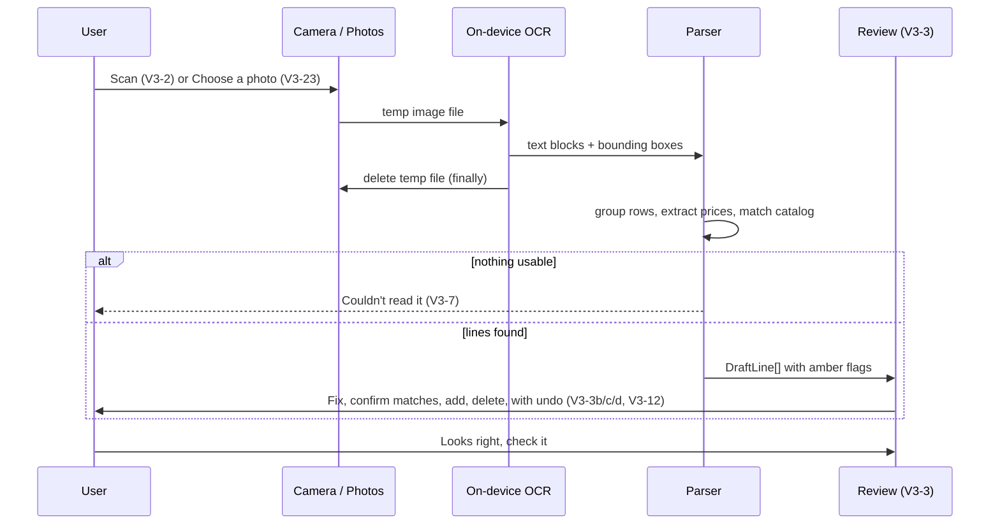
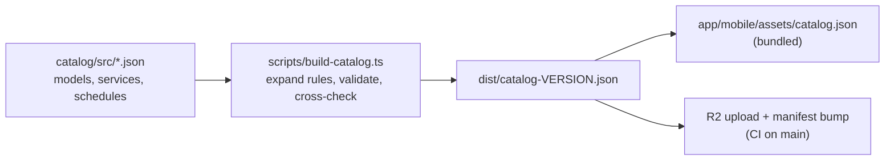

# PMS Check: System Design

Status: draft v2, 2026-11-25. Revised after a three-model adversarial review.
Scope: the mobile app (iOS and Android, Expo) and the thin backend it needs.
Design source: the Doop canvas "PMS Check", page "Version 3 · Glossy white" (frames V3-0 to V3-23, plus their Tagalog and body-style variants). Visual tokens live in `app/DESIGN.md`. This file covers data, behavior, and infrastructure, not visuals.

## 1. What the system does

A new car owner in the Philippines stands at a casa (dealer service) counter holding a PMS quote. The app tells them, line by line, what their manufacturer's schedule requires at this visit, what to check first, and what to decline. It also gives them words to say to the advisor.

The core loop has four steps:

1. **Know the car and the visit.** Model, variant, year, transmission, delivery month, odometer. At the start of each check the user confirms which service this visit is (for example "10,000 km / 12 months").
2. **Get the quote in.** Scan it, pick a photo, or type the lines. The user fixes anything the reader got wrong, including which catalog item a line was matched to.
3. **Judge every line.** Each line gets a verdict of *Say yes*, *Ask first*, or *Say no*, with a reason and a source. The verdict is computed once and saved with the quote.
4. **Act on it.** The user decides each *Ask first* line at the counter. The advisor card lists what to do, what to show first, and what to skip. History keeps the result.

**The safety rule.** The worst failure is telling a driver to skip work their car needs. So *Say no* is issued only when the line is a known upsell, matched with certainty, against the car's own schedule. Every other uncertain case becomes *Ask first*. Section 5.3 encodes this as an ordered table.

## 2. Decisions taken

| Decision | Choice | Consequence |
|---|---|---|
| Accounts | None in v1. Everything lives on the device. | No auth and no PII on the server. Uninstalling loses history. |
| Quote reading | On-device OCR plus a deterministic parser. The OCR engine is chosen by a spike in step 0 (section 6). | Free per scan and works offline at the counter. Accuracy depends on the parser and the review screen (V3-3). |
| Backend | Cloudflare Workers, with D1 and R2. | Stateless and cheap. It distributes catalog bundles and collects reports. It is never in the critical path of a check. |
| Schedule data | Curated JSON in this repo, bundled in the app, refreshed over the air. | Every schedule change gets a git review. The app works with no network on first launch. |

Two properties follow from these choices, and the rest of the design keeps them:

- **A check never needs the network.** Scan, parse, verdict, advisor screen, and history all run locally. The network only refreshes the catalog and sends reports.
- **The quote photo is never kept and never uploaded.** OCR libraries read from a file, so the photo exists as a temporary file for a few seconds. It is deleted right after recognition, on success and on failure, and a launch-time sweep deletes any leftover from a crash. Only the parsed lines are persisted. The V3 copy ("Nothing was saved") stays true under this rule.

## 3. System overview



## 4. Data shapes

Name the data first. Everything downstream (screens, verdicts, storage) reads from these types. Money is integer centavos, never floats. Ids are branded so a `ServiceId` can't be passed where a `VariantId` belongs.

### 4.1 Shared primitives

```ts
type Brand<T, B> = T & { readonly __brand: B };

type Centavos   = Brand<number, 'Centavos'>;   // integer, PHP x 100
type Km         = Brand<number, 'Km'>;         // integer kilometers
type ModelId    = Brand<string, 'ModelId'>;    // 'toyota-vios'
type VariantId  = Brand<string, 'VariantId'>;  // 'toyota-vios-1.3-xle'
type ServiceId  = Brand<string, 'ServiceId'>;  // 'engine-oil-filter'
type ScheduleId = Brand<string, 'ScheduleId'>; // 'toyota-vios-1.3-cvt-2023'
type YearMonth  = Brand<string, 'YearMonth'>;  // '2025-03'
type Locale     = 'en' | 'fil';
type Localized  = Record<Locale, string>;
type BodyStyle  = 'sedan' | 'hatchback' | 'suv' | 'mpv' | 'pickup';
type Transmission = 'manual' | 'cvt' | 'at';
type YearRange  = { from: number; to: number };
```

### 4.2 Catalog (read-only, shipped as one versioned bundle)

The catalog is the product's knowledge. It is authored in git, validated in CI, and immutable once published.

```ts
interface CatalogBundle {
  version: string;               // '2026.11.25-1'
  models: CarModel[];
  services: ServiceItem[];
  schedules: Schedule[];
}

interface CarModel {
  id: ModelId;
  make: string;                  // 'Toyota'
  name: string;                  // 'Vios'
  defaultBodyStyle: BodyStyle;   // V3-9b: "Picked from your model"
  years: YearRange;
  variants: Variant[];
  fallbackScheduleId: ScheduleId; // V3-22: "Use the Vios 1.3 schedule"
}

interface Variant {
  id: VariantId;
  label: string;                 // '1.3 XLE'
  years: YearRange;
  schedules: ScheduleBinding[];  // one per (year range, transmission)
}

interface ScheduleBinding {
  years: YearRange;
  transmission: Transmission;
  scheduleId: ScheduleId;
}

type ServiceKind =
  | 'scheduled'  // appears in maker schedules: oil, filters, fluids, inspections
  | 'wear'       // replaced when an inspection finds wear: pads, rotors, battery, tires, wipers, bulbs
  | 'upsell';    // never required by any maker schedule: engine flush, injector cleaning

interface ServiceItem {
  id: ServiceId;
  kind: ServiceKind;
  name: Localized;               // 'Engine flush'
  category: Localized;           // display grouping only, never a key
  aliases: string[];             // OCR and typing matches: 'ENGINE FLUSH', 'ENG FLUSH', ...
  priceRange?: { min: Centavos; max: Centavos }; // V3-14 sample range
  whyOffered?: Localized;        // V3-5 "Why they offer it"
  sayYesOnlyIf?: Localized;      // V3-5 amber callout
}

interface Schedule {
  id: ScheduleId;
  source: SourceRef;             // owner's manual citation
  items: ScheduledItem[];
}

interface ServicePoint {
  km: Km;                        // 10,000 / 200,000 / ...
  months: number;                // 12 / 120 / ... ("whichever comes first")
}

interface Interval {
  km: Km | null;                 // null: this clock never triggers the item
  months: number | null;         // brake fluid "every 3 years" is { km: null, months: 36 }
}

interface ItemRule {
  at: ServicePoint[];            // fixed milestones first: coolant "at 200,000 km or 10 years"
  every: Interval | null;        // then repeating, counted from the last `at` (or from zero)
}

type Conditions = 'normal' | 'severe';

interface ScheduledItem {
  serviceId: ServiceId;          // must be kind 'scheduled'
  action: 'replace' | 'inspect' | 'clean' | 'adjust';
  normal: ItemRule;
  severe?: ItemRule;             // the manual's "Severe" row, when it prints one
}

interface SourceRef {
  title: string;                 // "Vios owner's manual, 2025"
  page?: string;
}
```

**Why each item carries its own rule.** An earlier draft stored the manual as one shared list of service points, with each item due at some of them. The first real manual transcribed (Honda City, Philippines models, pp. 404–406) doesn't fit that. Each row sets its own interval, and the km and time clocks run at different ratios per row: engine oil every 10,000 km or 1 year, oil filter every 20,000 km or 2 years, brake fluid every 3 years with no km limit, spark plugs every 100,000 km with no time limit, coolant at 200,000 km or 10 years and then every 100,000 km or 5 years. Forcing those onto shared points gives wrong verdicts for cars driven little or a lot. So each `ScheduledItem` stores the row as the manual words it. A table of dots on a column grid becomes an `every` rule read straight off the dots (dust and pollen filter at every 20,000 km / 12 month column is `every: { km: 20000, months: 12 }`), and an irregular row lists its first dots in `at`.

**Normal and severe.** Manuals print a severe row for some items (Honda: oil, oil filter, manual transmission fluid). Severe covers stop-and-go traffic, heat above 35°C and dusty roads, which describes most Philippine driving, so the engine applies `severe` by default and falls back to `normal` where an item has no severe row (§11.1).

**What the build script checks.** Every rule has at least one non-null clock, `at` milestones are increasing, and each item names the manual page its row came from.

**Why the schedule is bound per year and transmission.** CVT fluid, ATF, and manual gear oil have different rows, and manuals change between model years. `Car.year` and `Car.transmission` pick the `ScheduleBinding`. The build script fails if a variant's bindings overlap or leave a gap in its years and transmissions.

**Why `ServiceItem.kind` exists.** It is the input to the safety rule. Only an `upsell` item can produce *Say no*. Brake pad replacement is `wear`, so it can never be told to skip. The build script checks that every `ScheduledItem` points at a `scheduled` item and that no `upsell` item appears in any schedule.

### 4.3 User data (local SQLite)

```ts
interface Car {
  id: string;                    // uuid
  modelId: ModelId;
  variantId: VariantId | null;   // null = V3-22 variant not listed, use fallback
  year: number;
  transmission: Transmission;
  deliveredOn: YearMonth;        // starts the "months" clock
  bodyStyle: BodyStyle;          // V3-9b, overridable
  odometer: { km: Km; readAt: string };
  isCurrent: boolean;            // V3-17 "Current"
  createdAt: string;
}

type LineMatch =
  | { kind: 'exact'; serviceId: ServiceId }      // alias matched after normalization
  | { kind: 'fuzzy'; serviceId: ServiceId }      // best guess, shown in amber
  | { kind: 'confirmed'; serviceId: ServiceId }  // user picked or accepted it
  | { kind: 'none' };                            // "Add 'eng' as typed"

type LinePrice =
  | { kind: 'read'; value: Centavos }
  | { kind: 'unsure'; guess: Centavos }          // V3-3 amber "Is it ₱750?"
  | { kind: 'missing' }
  | { kind: 'confirmed'; value: Centavos };

interface DraftLine {                            // in memory, during V3-3
  id: string;
  rawText: string;
  match: LineMatch;
  price: LinePrice;
  origin: 'scanned' | 'typed';
}

interface SavedLine {                            // persisted at "Looks right, check it"
  id: string;
  rawText: string;
  match: Exclude<LineMatch, { kind: 'fuzzy' }>;
  price: Centavos;
  verdict: Verdict;                              // computed once, stored
  decision: Decision;
}

type Decision = 'accept' | 'decline' | 'pending';

interface Quote {
  id: string;
  carId: string;
  shopName: string | null;       // 'Bayan Motors', read from header or typed
  visit: { point: ServicePoint; odometerKm: Km };  // confirmed at check start
  scheduleId: ScheduleId;
  usedFallbackSchedule: boolean;
  catalogVersion: string;        // audit only, never used to recompute
  quotedTotal: Centavos | null;
  lines: SavedLine[];
  createdAt: string;
}
```

**Draft and saved lines are different types.** A `DraftLine` may be unsure about its name or price. The "Looks right, check it" button is enabled only when every line has a `read` or `confirmed` price and no `fuzzy` match. Conversion to `SavedLine` is the only path into the verdict engine, so an unconfirmed fuzzy match or a missing price can't reach it.

**Quote status is derived, not stored.** A quote with any `pending` line shows "Checking" in V3-16. Once every line is `accept` or `decline`, it shows "Saved ₱X", where X is the sum of declined prices. Section 5.5 covers this.

### 4.4 Verdicts (computed once, then stored)

```ts
type VerdictKind = 'yes' | 'ask' | 'no';

interface Verdict {
  kind: VerdictKind;
  reason: VerdictReason;
  source: SourceRef | null;
}

type VerdictReason =
  | { kind: 'due-now' }                                  // "All in Toyota's schedule"
  | { kind: 'other-visit'; next: Milestone | null; last: Milestone | null }
                                                         // "Due at 40,000 km" or "Was due at 40,000 km. Ask if it was done."
  | { kind: 'wear-item' }                                // "Ask to see the worn part"
  | { kind: 'not-in-your-schedule' }                     // scheduled item, but not for this car
  | { kind: 'approximate-schedule' }                     // upsell, but the schedule is a fallback
  | { kind: 'not-in-schedule' }                          // upsell, certain: the only path to 'no'
  | { kind: 'unknown-item' };                            // typed or unmatched line
```

Verdicts are computed once, when the quote is saved, and written into `quote_line`. History reads stored facts. Updating the odometer, editing the car, or a new catalog version never changes a saved result or its "Saved" amount. The app therefore keeps only the current catalog bundle, not every past version.

## 5. Core logic

All of this is pure TypeScript in `app/mobile/src/core/`, with no React and no I/O. It is the most tested code in the repo.

### 5.1 Resolve the schedule

```
resolveSchedule(car, catalog) -> { schedule, usedFallback: boolean }
```

Pick the variant's `ScheduleBinding` matching `car.year` and `car.transmission`. If `car.variantId` is null, or no binding matches, set `usedFallback` and keep the transmission. Take the binding with the same transmission and the nearest years, from the car's own variant first, then from any variant of the model. Transmission items like CVT fluid only apply to their own gearbox. Use the model's `fallbackScheduleId` only when no binding has the car's transmission.

### 5.2 Which service visit

```
cadence(schedule, conditions) -> ServicePoint      // the shortest km and months interval any item asks for
reachedPoint(odometerKm, ageMonths, cadence, tolerance) -> { point, status: 'due-now' | 'overdue', overKm, overMonths } | { point: null }
nextPoint(odometerKm, ageMonths, cadence) -> { point, inKm, inMonths }
```

- Visits are multiples of the cadence. Under severe conditions the City's cadence is 5,000 km or 6 months, set by the oil change.
- A visit is reached when `odometerKm >= point.km - tolerance.km` **or** `ageMonths >= point.months - tolerance.months` (whichever comes first). Defaults: 1,000 km and 1 month.
- `reachedPoint` returns the latest reached visit, on whichever clock is further along. It is `due-now` while both overruns are within tolerance, otherwise `overdue`. V3-11 "You're 240 km past it" is `due-now` with `overKm = 240`.
- `nextPoint` drives V3-1 ("in 9,760 km, after this 20,000 km").
- These drive Home and car setup only. The verdict never reads them.
- `ageMonths` comes from `car.deliveredOn` and today's date.

**The visit is confirmed, not inferred.** At the start of every check (`check/visit`), the app prefills the service point from `reachedPoint` and the quote header when it is read ("10K PMS"), and asks the user to confirm. If `odometer.readAt` is older than 14 days, the same screen asks for a fresh reading first. The confirmed `visit` is the only service input to the verdict. The odometer saved at car setup never decides a verdict on its own.

### 5.3 Verdict per line

```
verdict(line: SavedLine-without-verdict, schedule, visit: ServicePoint, conditions, usedFallback, catalog, tolerance) -> Verdict
```

`visit` is the confirmed visit: its km and the car's age in months. An item is *due* at the visit when, on either clock, the visit is within tolerance of one of the item's milestones (its `at` points, then each repeat of `every`).

An ordered table. The first matching row wins, and the last row catches everything, so every input has exactly one answer.

| # | Condition | Verdict | Reason |
|---|---|---|---|
| 1 | `match.kind` is `none` | ask | unknown-item |
| 2 | item is in this schedule and due at the visit | yes | due-now |
| 3 | item is in this schedule but not due at the visit | ask | other-visit (nearest later and earlier milestone, on the km clock when the rule has one) |
| 4 | item kind is `wear` | ask | wear-item |
| 5 | item kind is `scheduled`, absent from this schedule | ask | not-in-your-schedule |
| 6 | item kind is `upsell` and `usedFallback` | ask | approximate-schedule |
| 7 | item kind is `upsell` | no | not-in-schedule |

Row 2 says *yes* to scheduled inspections too, because the inspection itself is part of the PMS. A replacement found by that inspection is a different, `wear` item, which lands on row 4.

Row 3 covers missed services. A coolant change due at 200,000 km, quoted at a 210,000 km visit, is *Ask first* with "Was due at 200,000 km. Ask if it was done." It is never *Say no*.

*Say no* has exactly one path, row 7. It needs a line matched with certainty (exact alias or user-confirmed), an item the catalog marks as an upsell, and the car's own schedule. Price is not a verdict input. An out-of-range price is shown as a separate note, because a fair price does not make a service required.

### 5.4 Totals and sanity

- `totals` sums line prices by verdict kind (V3-4 tiles).
- `totalCheck` compares the line sum to `quotedTotal` and drives V3-3e ("A ₱150 line may be missing"), with "Add a missing line" or "Carry on anyway".

### 5.5 Decisions, the advisor card, and "Saved"

Each saved line starts with a decision from its verdict: `yes` gives `accept`, `no` gives `decline`, `ask` gives `pending`. The user changes a decision on the item detail screen (V3-5) at the counter, after asking.

`advisorCard(quote, locale)` builds V3-6 in its three blocks, matching the design:

- **"Please do only these"** lists `accept` lines, with "I will pay" as their sum.
- **"Show me first"** lists `pending` lines. They are never dropped from the card.
- **"Not today, thank you"** lists `decline` lines.

The V3-5 "Say this" line is a template too, in English or Filipino. Neither calls an LLM.

"Saved" on a quote is the sum of `decline` lines, and it appears only once no line is `pending`. "You've saved" on V3-16 sums only those finished quotes. A user who never resolves an *Ask first* line keeps the quote in "Checking", which is honest.

## 6. Quote reading pipeline



**Capture.** `expo-camera` renders a live preview under V3-2's custom frame guide, "Hold steady" chip, and torch toggle. The system picker from `expo-image-picker` covers "Choose a photo" and needs no photo-library permission. We use these instead of a native scanner UI because V3-2 is a custom screen, and both libraries run in Expo Go. The camera permission flow is V3-18 (ask) and V3-19 (denied, deep link to Settings). Both paths offer "Type the lines instead". `src/ocr/capture.ts` is the only module that creates or deletes quote images.

**OCR engine, chosen by a spike.** The review found that `@react-native-ml-kit/text-recognition` runs Google ML Kit on both platforms, not Apple Vision on iOS. Its last release was 2025-09, and nobody has confirmed it on React Native 0.88 with the New Architecture. Step 0 compares candidates on the real quote photos:

| Candidate | Engine | Check in the spike |
|---|---|---|
| `expo-text-extractor` | ML Kit on Android, Vision on iOS (reported) | Builds on SDK 58, output shape, confidence |
| `@react-native-ml-kit/text-recognition` | ML Kit on both | New Architecture support on RN 0.88 |
| Small custom Expo module | ML Kit on Android, Vision on iOS | Cost to own it |

The spike passes when the module builds on SDK 58, reads from a file URI the app deletes afterwards, and returns blocks with bounding boxes. Per-element confidence is a bonus. If no candidate exposes it, `unsure` prices come from digit-shape heuristics and the total check instead.

**Temp file lifecycle.** The capture or picker writes the image to the app cache. The OCR adapter deletes it in a `finally` block, on success and on failure. On launch, the app deletes any file left in its capture folder (crash or kill mid-read). Nothing else in the app gets the file path.

**Parse.** These steps are deterministic and fixture-tested against the step 0 photo set.

1. Cluster blocks into rows by vertical overlap.
2. In each row, take the right-most token matching a peso amount as the price. The rest of the row is `rawText`.
3. Detect the total row into `quotedTotal`. Detect the header (shop name, service point such as "10K PMS") when present, to prefill the visit.
4. Match `rawText` against catalog `aliases` after normalization (uppercase, strip punctuation and spacing). An exact alias hit is `exact`. Otherwise, fuzzy matching (token overlap plus edit distance) proposes the best candidate as `fuzzy`, but only when it beats the runner-up by a clear margin. Otherwise the match is `none`.
5. Flag prices with low OCR confidence or odd digit shapes as `unsure`, with the best guess.
6. If no priced row is found, return "couldn't read".

**Review is part of the design, not a fallback.** V3-3 shows every line. A `fuzzy` line shows the catalog name it was matched to under the raw text, in amber, and needs one tap to confirm or change. An `unsure` price is amber too. The parser does not need to be perfect. It needs to be honest about what it is unsure of, and the type system makes sure nothing unsure reaches a verdict.

**Typing path.** V3-13 and V3-14 are a catalog search over `name` and `aliases`, then a price keypad that shows the item's `priceRange`. A picked item is `confirmed`. Free text not in the catalog is `none`.

## 7. Mobile app architecture

### 7.1 Stack

| Concern | Choice |
|---|---|
| Framework | Expo SDK 58, React Native 0.88, TypeScript, already scaffolded in `app/mobile` |
| Navigation | expo-router (file routes, typed) |
| Local storage | expo-sqlite. One database holds cars, quotes, lines, outbox, settings, and the current catalog bundle. |
| In-flight state | A `useReducer` for the quote draft, with an undo stack for V3-3b/c/d toasts. It lives in a context scoped to the check flow. |
| Validation | zod at every boundary: catalog bundle load, SQLite row read, network responses |
| i18n | A small typed dictionary for `en` and `fil`, chosen on V3-0 and switchable on Home |
| Analytics | posthog-react-native, anonymous, with no person profiles (same policy as the landing page) |
| Builds | EAS Build for store binaries. EAS Update for JS and bundled-catalog updates. |

There is no global state library. The data that persists is in SQLite. The data that is in flight is one reducer, and it lives exactly as long as the check flow.

### 7.2 Routes

```
src/app/
  _layout.tsx                 language gate (V3-0), catalog load, db migrate, temp-file sweep
  (tabs)/
    index.tsx                 Home (V3-1), due service, past-quotes tile
    cars.tsx                  Your cars (V3-17)
    quotes/index.tsx          Past quotes (V3-16, V3-16b)
  car/
    model.tsx                 Pick the model (V3-8)
    variant.tsx               Variant, year, transmission (V3-9), not listed (V3-22)
    delivered.tsx             Delivery month (built without a frame, see section 11)
    look.tsx                  Body style (V3-9b)
    odometer.tsx              Odometer (V3-10)
    saved.tsx                 Car saved (V3-11)
  check/
    _layout.tsx               owns the QuoteDraft reducer
    visit.tsx                 Confirm odometer and service point (built without a frame, see section 11)
    scan.tsx                  Allow camera (V3-18), camera off (V3-19), Scan (V3-2), Choose a photo (V3-23)
    reading.tsx               Reading the quote (V3-15), couldn't read (V3-7)
    lines.tsx                 Check the lines (V3-3, 3b-3e), Edit a line sheet (V3-12)
    add.tsx                   Type a line (V3-13), Add the price (V3-14)
    result.tsx                Result (V3-4, V3-4b)
    item/[lineId].tsx         Item detail and decision (V3-5), Report a mistake (V3-21)
    advisor.tsx               Show the advisor (V3-6, V3-6b)
```

### 7.3 Module layout

```
app/mobile/src/
  core/        pure logic: types, resolveSchedule, reachedPoint, verdict, totals, advisorCard, parser
  catalog/     bundle loading, OTA refresh
  db/          SQLite schema, migrations, repositories (cars, quotes, outbox)
  ocr/         capture + text-recognition adapter -> TextBlock[], temp-file lifecycle
  i18n/        en.ts, fil.ts, typed keys
  ui/          V3 components from app/DESIGN.md (GlassButton, Tile, Line, Toast, AdvisorPanel)
  app/         routes only, thin
```

Boundaries are guarded once. `catalog/`, `db/`, and `ocr/` parse untrusted input into `core` types. `core` trusts its inputs and has no defensive checks.

### 7.4 Local schema

```sql
CREATE TABLE car (
  id TEXT PRIMARY KEY, model_id TEXT NOT NULL, variant_id TEXT,
  year INTEGER NOT NULL, transmission TEXT NOT NULL, delivered_on TEXT NOT NULL,
  body_style TEXT NOT NULL,
  odometer_km INTEGER NOT NULL, odometer_read_at TEXT NOT NULL,
  is_current INTEGER NOT NULL DEFAULT 0, created_at TEXT NOT NULL
);
CREATE UNIQUE INDEX one_current_car ON car(is_current) WHERE is_current = 1;

CREATE TABLE quote (
  id TEXT PRIMARY KEY, car_id TEXT NOT NULL REFERENCES car(id) ON DELETE CASCADE,
  shop_name TEXT,
  visit_point_km INTEGER NOT NULL, visit_point_months INTEGER NOT NULL,
  visit_odometer_km INTEGER NOT NULL,
  schedule_id TEXT NOT NULL, used_fallback_schedule INTEGER NOT NULL,
  catalog_version TEXT NOT NULL, quoted_total INTEGER, created_at TEXT NOT NULL
);

CREATE TABLE quote_line (
  id TEXT PRIMARY KEY, quote_id TEXT NOT NULL REFERENCES quote(id) ON DELETE CASCADE,
  position INTEGER NOT NULL, raw_text TEXT NOT NULL,
  match_kind TEXT NOT NULL, service_id TEXT,
  price INTEGER NOT NULL,
  verdict TEXT NOT NULL,             -- JSON Verdict, written once
  decision TEXT NOT NULL             -- 'accept' | 'decline' | 'pending'
);

CREATE TABLE outbox (
  id TEXT PRIMARY KEY, kind TEXT NOT NULL, payload TEXT NOT NULL,
  created_at TEXT NOT NULL, attempts INTEGER NOT NULL DEFAULT 0
);

CREATE TABLE catalog_current (id INTEGER PRIMARY KEY CHECK (id = 1), version TEXT NOT NULL, json TEXT NOT NULL);
CREATE TABLE setting (key TEXT PRIMARY KEY, value TEXT NOT NULL);
```

The partial unique index enforces "one current car" in the database instead of in app code. A quote is written once, when the user taps "Looks right, check it". After that, only `quote_line.decision` changes. Drafts stay in memory, which matches "Nothing is saved yet".

## 8. Backend (Cloudflare)

The backend is small on purpose. It has two jobs: serve catalog bundles, and receive reports. It stores nothing about a user's car or quotes.

### 8.1 Endpoints

| Method and path | Purpose | Storage |
|---|---|---|
| `GET /v1/catalog/manifest` | Returns `{ version, sha256, url, minAppVersion }` | KV or a constant in the Worker |
| `GET /v1/catalog/:version.json` | The immutable bundle, cached at the edge for a long time | R2 |
| `POST /v1/reports` | Report a mistake (V3-21) | D1 `report` |
| `POST /v1/demand` | "Not listed" signals: a missing model, variant, or typed item | D1 `demand` |

### 8.2 D1 schema

```sql
CREATE TABLE report (
  id TEXT PRIMARY KEY,               -- client uuid, makes retries idempotent
  reason TEXT NOT NULL,              -- 'in-schedule' | 'price-range' | 'wrong-car' | 'other'
  note TEXT,
  service_id TEXT, schedule_id TEXT, variant_id TEXT, visit_point_km INTEGER,
  catalog_version TEXT NOT NULL, app_version TEXT NOT NULL, locale TEXT NOT NULL,
  created_at TEXT NOT NULL
);

CREATE TABLE demand (
  id TEXT PRIMARY KEY,
  kind TEXT NOT NULL,                -- 'model' | 'variant' | 'service'
  text TEXT NOT NULL, model_id TEXT, created_at TEXT NOT NULL
);
```

Neither table has a device id, a price, or a photo. Inserts use `INSERT OR IGNORE` on the client uuid, so outbox retries never create duplicates.

### 8.3 Abuse and limits

- Cloudflare rate-limiting rules per IP on the two POST routes.
- zod validation and length caps on `note` (500 characters) and `text` (80 characters).
- No secrets ship in the app, because no endpoint needs one.

### 8.4 Outbox

Reports and demand signals go into the local `outbox` first, then a flush runs on app foreground and on network regain. The id is the idempotency key, so a crash mid-flush is safe. V3-21 copy ("We check every report against the manual before changing a verdict") holds, because a report never changes a verdict directly. A human fixes `catalog/`, and a new bundle ships. Saved quotes keep their stored verdicts.

## 9. Catalog pipeline



- **Authoring.** One file per model under `catalog/src/models/`, transcribed from the owner's manual table. Services live in `catalog/src/services.json` with their `kind`, English and Filipino names, and aliases. Every schedule cites its source. A PR that changes a schedule shows the diff and the source in review.
- **Build script.** It is the lever. It validates types and fails CI on any of these:
  - a `serviceId` or `scheduleId` that doesn't resolve
  - a variant's bindings that overlap or leave a year or transmission uncovered
  - a rule with no clock set, or `at` milestones out of order
  - a `ScheduledItem` pointing at a `wear` or `upsell` item
  - an `upsell` item appearing in any schedule
- **Golden verdicts.** Each schedule has fixture quotes with expected verdicts, run in CI, so a schedule edit that flips a verdict shows up in review.
- **Distribution.** The app ships with the latest bundle, so first launch works offline. On foreground, at most once a day, the app checks the manifest. If the version differs from `catalog_current`, it downloads the bundle, verifies the sha256, validates it with zod, and replaces `catalog_current`. A bad bundle is rejected and the current one keeps working. New checks use the new bundle. Saved quotes are unaffected, because their verdicts are stored.
- **Coverage at launch.** The landing page names Toyota Vios and Wigo, Mitsubishi Mirage, Honda City, Suzuki Ertiga, and Nissan Almera.

## 10. Privacy, security, analytics

- **No accounts and no PII.** The server never sees a plate number, VIN, name, quote photo, or quote price.
- **Photos are temporary.** The quote image exists only as a cache file during recognition. It is deleted right after, on success or failure, and swept on launch if a crash left one. It is never uploaded.
- **Analytics are anonymous.** PostHog uses `person_profiles: 'identified_only'` and never identifies anyone. Proposed events: `language_chosen`, `car_saved`, `scan_started`, `scan_failed {reason}`, `lines_confirmed {count, edited_count}`, `verdict_shown {yes, ask, no}` (counts only), `advisor_shown`, `script_copied`, `report_sent {reason}`. Event properties never include prices or free text.
- **The privacy policy** on the landing page (`landing-page/src/pages/privacy.astro`) needs an app section that states the above.

## 11. Open questions

1. **Normal or severe schedule.** Decided: severe is the default (§4.2). Still open is whether car setup should let an owner who drives in light traffic switch to normal.
2. **Two screens have no frame yet.** The delivery month step (`car/delivered`) is built from the year and month chips of V3-9. The visit step (`check/visit`) is built from the odometer keypad of V3-10 and the radio rows of V3-9. Both need a design pass. The visit step runs before the scan, so it can't yet prefill from the quote header (section 5.2). The item detail screen (V3-5) also needs accept and decline controls for *Ask first* lines.
3. **Tolerance defaults.** 1,000 km and 1 month around a service point are assumed in section 5.2. Confirm against how casas actually book PMS.
4. **`ask` for out-of-range prices.** Section 5.3 keeps price out of the verdict. Confirm that this is the product intent.
5. **The serif schedule note** (`app/DESIGN.md`, Typography) is still unresolved. It has no system impact, but it is listed so it isn't lost.
6. **The mock quote in the design doesn't add up.** V3-3 lists six lines that sum to ₱8,150 but says they add up to ₱14,000. V3-4 shows ₱1,800 to ask and ₱8,800 to say no, while the lines imply ₱750 to ask (cabin air filter) and ₱4,000 to say no (engine flush plus fuel injector cleaning). The frames need consistent sample data. Engine tests no longer depend on them (section 12).
7. **`app/web` is empty.** This design assumes v1 is mobile only and that the Astro landing page stays separate. Expo can also build for the web from `app/mobile` if needed.

## 12. Build order

Riskiest unknowns first. Each step ends in something you can check.

0. **Ground truth and the OCR spike.** Collect 30 or more real casa quote photos across brands, with the expected lines written down as JSON. Collect the owner's manuals for the launch models, including their maintenance tables. Run the OCR spike from section 6 on the photos. Done when the OCR engine and camera library are chosen, with numbers, and the fixture set is committed.
1. **Catalog scaffold.** Add `catalog/src`, the build script with every check in section 9, and the Vios with all its variants and bindings, transcribed from the manual. Done when CI validates it and emits a bundle.
2. **Core engine.** Build `resolveSchedule`, `reachedPoint`, `verdict`, `totals`, and `advisorCard`. Write golden tests from the manual table and from the step 0 quotes. They must cover every row of the verdict table, the first service, a time-only item, a missed fixed-point item, a wear item, and a fallback schedule. Done when the tests pass.
3. **Typed path end to end.** Car setup including delivery month, the visit confirm step, typing the lines, result, decisions, advisor card, and history in SQLite, with no camera. Done when a quote can be checked on a device in airplane mode, and editing the car afterwards leaves its saved result unchanged.
4. **Parser.** Done when accuracy is measured on the step 0 set, every miss shows as amber rather than a silent wrong price or match, and no fixture produces a *Say no* that its expected lines don't.
5. **Camera flows.** Permission (V3-18, V3-19), scan, choose a photo, couldn't read, and the temp-file lifecycle. Done when a test confirms the cache folder is empty after a read, after a failed read, and after a kill and relaunch.
6. **Worker.** Manifest, bundle, reports, demand, and the outbox. Done when a report sent offline lands once in D1 after reconnecting.
7. **Filipino copy, body styles, and the remaining models.**
