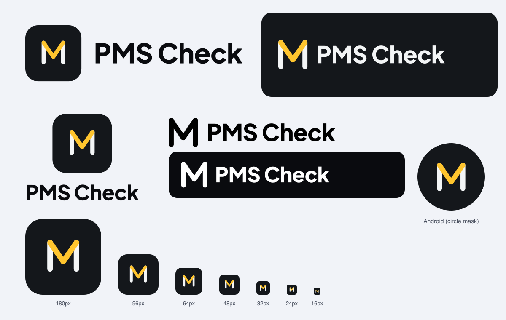

# PMS Check logo



## The idea

An **M**, for Maintenance, drawn as two legs and a V. The V is the colour shift: it is the part of the service that got checked. Ink and panel come from the app's dark set; the V is Showroom Yellow, used the way `app/DESIGN.md` intends: a small signal on a dark surface.

## Colours

| Role | Name | HEX | RGB |
|---|---|---|---|
| Tile | Panel | `#14171B` | 20 23 27 |
| Legs on dark | Panel Ink | `#F3F5F6` | 243 245 246 |
| Middle (V) | Showroom Yellow | `#FFC52E` | 255 197 46 |
| Middle, not yet checked | Guide | `#3A3F45` | 58 63 69 |
| Wordmark on light | Ink | `#0A0B0F` | 10 11 15 |

Pantone/CMYK are not yet matched. Get a print proof before the first print run.

## Which file to use

| Use | File |
|---|---|
| Light backgrounds (default) | `svg/pms-check-horizontal.svg`, `svg/pms-check-stacked.svg` |
| Dark backgrounds | `svg/pms-check-horizontal-dark-bg.svg`, `svg/pms-check-stacked-dark-bg.svg` |
| One colour (print, stamp, embroidery) | `svg/pms-check-horizontal-black.svg`, `-white.svg`, `svg/pms-check-symbol-black.svg`, `-white.svg` |
| Icon / avatar | `svg/pms-check-icon.svg` (rounded), `svg/pms-check-icon-square.svg` (full bleed, platforms round it) |
| 32 px and below | `svg/pms-check-icon-small.svg` (thicker strokes, shallower V) |
| App splash only | `svg/pms-check-icon-unchecked.svg`: the V in Guide grey. The app inks it yellow as it opens, so it is never shown as a finished logo anywhere else. |
| Raster copies | `png/`, web icons in `web/` |

The symbol in full colour always sits on the dark tile when the background is light. Yellow on white is too faint to carry the V.

## Clear space and minimum size

- Clear space around any lockup: one quarter of the tile's height on every side.
- Minimum sizes: icon 16 px (use the small cut up to 32 px); horizontal lockup 120 px wide; stacked lockup 64 px wide.

## Don't

- Recolour the legs and the V the same on the full-colour version, or swap their colours.
- Put the full-colour symbol straight on white or yellow without the tile.
- Add gloss, gradients, outlines or shadows to the tile. The flat tile is the approved icon.
- Stretch, rotate, or reset the wordmark in another font. It is Plus Jakarta Sans ExtraBold, converted to outlines.

## Where it is wired in

- `app/mobile/assets/images/`: `icon.png` (opaque 1024), `splash-icon.png` (the unchecked tile), `favicon.png`, `android-icon-*.png`.
- `app/mobile/app.json`: iOS uses `icon.png` (the default `expo.icon` bundle is no longer referenced), Android adaptive background `#14171B`.
- `landing-page/public/`: `favicon.svg`, `favicon.ico`, `apple-touch-icon.png`, linked in `src/layouts/Base.astro`. The site header and footer use `src/components/Brand.astro`: the small icon next to live "PMS Check" text (Plus Jakarta Sans 800) at the lockup proportions. Live text renders sharper on screen than the outlined lockup.

## Rebuilding

All SVGs come from one geometry in `source/build.py`. `source/export.sh` regenerates every SVG and PNG and copies the icons into the app and landing page. It needs a Python with `fonttools`:

```sh
python3 -m venv /tmp/logo-venv && /tmp/logo-venv/bin/pip install fonttools
PYTHON=/tmp/logo-venv/bin/python branding/source/export.sh
```

## Before public launch

- Run a trademark search (IPOPHL for the Philippines, plus a reverse-image search). A two-colour M is a common shape.
- Plus Jakarta Sans is under the SIL Open Font License, which allows use in a logo.

